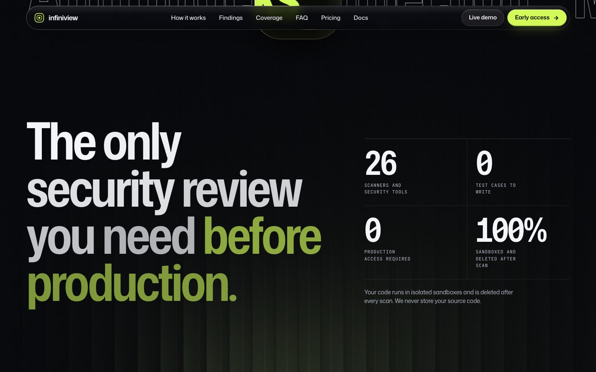
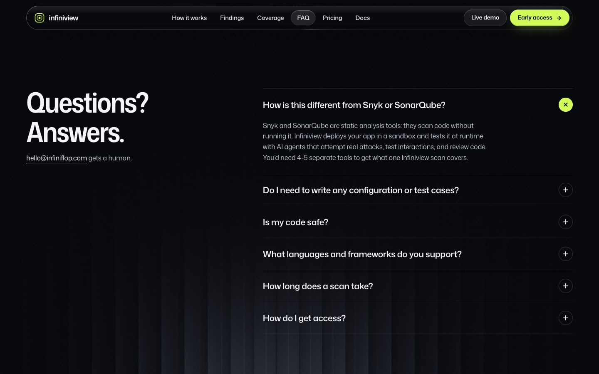
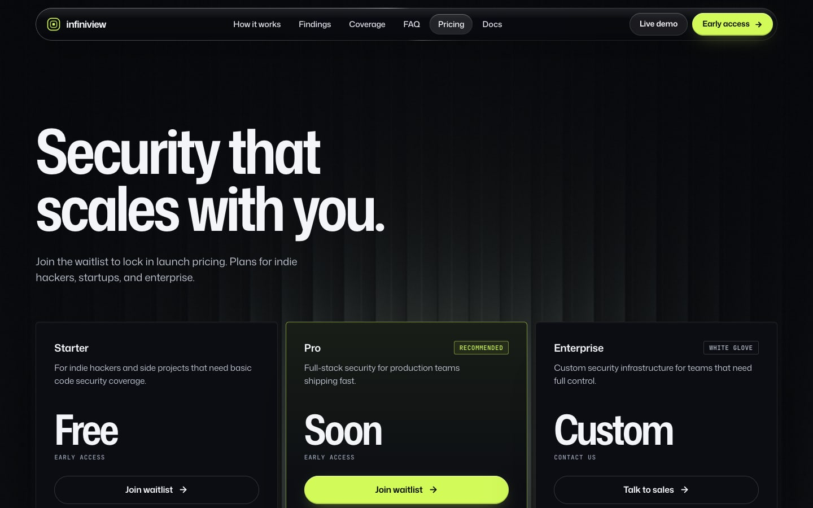

# Infiniview marketing site: redesign notes

This branch (`redesign/fable-20261115`) replaces the presentation of the marketing site (`/` and
`/pricing`, plus the 404 and error pages) after an audit of the previous design. The product demo at
`/preview` is untouched. Product claims, the waitlist API contract and external links are preserved;
nothing new is claimed.

Companion documents in this folder:

| File | What it is |
| --- | --- |
| `plan.md` | The audit of the previous site (P0 to P2 findings with evidence paths) and the plan |
| `concept.md` | Three concept directions, the critique of each, and the one that was built |
| `reference-study.md` | First-hand study of 24 sites in Chromium and WebKit, and the decision map |
| `motion-system.md` | The motion tokens, springs and per-chapter choreography |
| `skills-evidence.md` | Which design skills were loaded and what each one shaped |
| `design-review.md` | The review rounds, the independent critic's scores, what was fixed |
| `PROGRESS.md` | Checklist and log of the work |

## The idea: hard product, liquid glass

Infiniview's mark is a viewfinder: a frame, a frame inside it, a point of focus. The site makes that
literal. Everything that is Infiniview's work (the sample app under test, the run, the findings, the
proof, the pull-request check) is drawn like the product: square corners, hairlines, mono labels,
the dashboard's own ground. The only soft thing on the page is glass, there are few pieces of it,
and each chapter gives it one job.

Colour carries meaning, nothing else does:

| Colour | Means |
| --- | --- |
| lime `#d2fb5a` (the brand and product colour) | verified, proof, the primary action |
| vermilion `#ff5a47` | an exploit |
| four lane colours (lavender, cyan, vermilion, lime) | the four layers of a scan, wherever they appear |

Type is **Mona Sans** (variable: weight and width) for everything, with **JetBrains Mono** for real
traces, code and the labels on product surfaces. Display type sits on the narrow end of the width
axis so it can be very large; labels are 11 px mono; little in between.

### The page, chapter by chapter

1. **Hero.** "Attack your code before anyone else does.", one sentence, the waitlist, and a sample
   app (a small admin console) under a glass lens. The lens is the mark's outer frame. Through it the
   app is seen as an attacker sees it: the search field becomes `q=%' OR 1=1 --`, the plan column
   becomes password hashes, a refund becomes "×5 in 1s". Move it with the pointer, drag it with a
   finger, or let it drift. Each weak point it settles on locks into a tray; the tray's buttons are
   also the keyboard path, and a found finding opens its proof in the console further down.
2. **Threat band.** The attack classes in two rows of outlined type, pulled through a slab of glass
   by scroll speed. Inside the slab they are caught: solid and lit.
3. **Statement.** "The only security review you need before production.", read word by word by the
   scroll, then four numbers set large and left alone.
4. **From pull request to proof.** One pinned stage, five beats: a pull request opens; a copy of the
   app is sealed in a glass chamber (the sandbox) while production stays untouched; four lanes of
   agents fire probes into it and the app turns to attack view; findings land where they were found
   and a duplicate merges; proof is bundled, the check on the pull request reads "2 critical, 1 high
   · merge blocked", and the sandbox is torn down. Scrub it with the scroll, drag its timeline, or
   press a step.
5. **Forensic findings.** The proof console: three sample findings, each with its HTTP proof, attack
   path, code and fix. The proof replays (requests are typed, responses arrive). It plays by itself
   until touched.
6. **Every layer, covered.** Four numbers (4 · 26 · 12 · 7), each with the things it counts. All 26
   scanners are listed by name, in their four families, with the opt-in ones marked.
7. **Connect your repo. That's it.** What a first connection produces, and four standing facts as a
   ledger.
8. **FAQ.**
9. **Finale.** The mark opens like an aperture and the screen floods with lime: "Think your app is
   unbreakable?" and the waitlist again.
10. **Footer.** The wordmark, full width, in glass.

`/pricing` uses the same system: the same plans, notes and FAQ on solid panes, and its own waitlist.

## Liquid glass, for real

Glass here is a functional layer for navigation and controls, floating over content, as Apple's
guidance asks. Content never sits on it. There are five pieces: the nav capsule, the lens, the slab,
the timeline handle, and the selection pills.

- **How it bends.** `lib/site/glass.ts` computes a displacement map from the shape of the glass: a
  rounded rectangle with a convex bezel. For each pixel inside the bezel a vertical ray is refracted
  with Snell's law (n = 1.5) and the offset is stored in the red and green channels of an image. An
  SVG `feDisplacementMap` moves the pixels. Red, green and blue are displaced in three passes by
  slightly different amounts and added back together: that is the colour fringe at the rim. Maps are
  built in the browser for each element's exact size and rebuilt when it changes.
- **Where the refraction is real in every engine.** The lens and the slab each hold a second copy of
  what is behind them, kept in register with it, and the filter is applied to that copy with plain
  `filter`. Chromium, WebKit and Firefox render the same refraction of live DOM text.
- **The nav.** In Chromium the same kind of map is the nav's `backdrop-filter`, so the bar blurs,
  bends and dims whatever really scrolls under it. Other engines get the designed fallback: a dense
  tint, `backdrop-filter: blur() saturate() brightness()`, and the same rim.
- **Rim, thickness, light.** One light, from the upper left, everywhere. Each piece of glass has a
  bright hairline where its rim faces the light and a fainter one opposite, a pool of light inside
  its upper edge and shade inside its lower edge. The lens carries a specular highlight that slides
  against its direction of travel; the nav's rim turns a few degrees with the pointer and the scroll.
- **Fallbacks.** `prefers-reduced-transparency` and `prefers-contrast: more` turn glass into solid
  tinted surfaces and switch the filters off. A struggling machine (`html[data-perf="low"]`) keeps
  tint and rim and drops blur and bending. Safari gets the slab without the bend: WebKit draws
  nothing when a filtered element contains content as wide as the threat rows.
- **Contrast is measured from pixels**, because axe cannot see through glass or a canvas. At every
  half-screen of scroll the page is captured, then captured again with all text transparent; where
  the two frames differ is exactly where glyphs are, so the text's colour and what is behind it are
  both read from pixels. Results are in the status section below.

## The wall

Behind the page is one WebGL layer: a wall of fluted glass with a light behind it
(`components/site/wall-shader.ts`, a single fragment shader, no textures, no library). Each flute is
a cylindrical lens that shows a mirrored slice of the light, so one soft light becomes vertical
ribbons whose edges split into colour; the split grows with scroll speed and settles when the page
does.

The light is a backlight. Each chapter stands it behind its own product surface (the hero's stage,
the sandbox, the console, the terminal, the plans) and it then travels with that surface as the
page scrolls, so its core is always behind something opaque and only its halo shows. It changes
colour with the story: cool white, vermilion while the agents attack, lime for proof. Chapters that
are type alone get a dim light at the foot of the screen. Copy never sits on the light.

## Motion

`motion-system.md` is the reference. In short:

- **One clock.** GSAP's ticker drives Lenis, ScrollTrigger, every spring and the shader.
- **Three roles.** Arriving eases out, moving eases both ways, leaving eases in and is shorter.
- **Springs for anything touched** (`lib/site/motion.ts`): a frame-rate independent solver that
  keeps velocity when re-aimed, so the lens, the pills and the timeline can be interrupted and
  reversed. 1:1 while a pointer is down; on release the spring starts at the release velocity and
  aims at where the throw would land (momentum projection).
- **No two chapters move the same way.** Word masks, a velocity marquee through glass, a sentence
  read by scroll, a pinned scrub, a replayed trace, numerals rising with their lane lines, an
  aperture.
- **The first screen needs nothing.** It is in the server's HTML and its entrance is CSS that starts
  with the first paint. It does not wait for script, the font or the canvas, and nothing is shown and
  then hidden again. Numbers are never counted up from a wrong value.
- **Reduced motion** is a designed still version: no smooth scroll, one still frame of the wall, the
  pipeline as a static finished stage with every step readable, no entrances. The lens still follows
  a pointer or a finger (that motion is the visitor's own) but does not drift, stretch or bounce.

## Engineering notes

- Next 16 App Router and Tailwind 4, as before. `(site)` holds the marketing routes with their own
  fonts, shell, nav and footer; `/preview` keeps its own. Dark only.
- Tokens and the design system are in `src/app/(site)/site.css`; the home page's sections are in
  `home.css`, imported by the home route only, so `/pricing` does not download them.
- Server-rendered; only interactive pieces are client components. Real HTML throughout: headings,
  tablists with arrow keys, accordions with `aria-expanded`, a slider role on the timeline handle, a
  skip link, visible focus. Decorative stages are `aria-hidden` and the copy beside them carries the
  content.
- Kept from the previous build, unchanged in behaviour: Lenis driven from GSAP's ticker, the reveal
  failsafe in the bootstrap script, scroll restoration through layout rebuilds, in-page anchor focus
  handling, the menu's modal behaviour, the waitlist form's states and the `POST /api/waitlist`
  contract (`{ success: true }`, `already_registered`), security headers, the 404 as a document of
  its own, safe areas, forced colours and print.
- Removed: the corridor shader, the count-up, the bento, the hero scan card, card tilt and magnetic
  buttons, the JavaScript gate on the first screen.
- New: `lib/site/motion.ts` (tokens, spring, pill, projection), `lib/site/glass.ts` (displacement
  maps), `components/site/glass-defs.tsx` (the SVG filters), `wall.tsx` and `wall-shader.ts`,
  `sample-app.tsx`, `coverage.tsx`, `after.tsx`, `light-cue.tsx`.
- Two engine quirks worth knowing: an ancestor with an opacity or transform animation becomes the
  backdrop root and silently empties a `backdrop-filter` (the nav's entrance is therefore on the bar
  itself); and a variable font's overlapping contours show through `-webkit-text-stroke`, so outlined
  type is drawn as eight one-pixel shadows of the glyph's silhouette instead.
- Social cards are regenerated from the live wall with `pnpm og` (site running); alt texts updated.
- No dependency was added or removed. `counter.tsx`, `arsenal.tsx`, `features.tsx` and
  `scan-card.tsx` are gone; `corridor*.ts(x)` became `wall*.ts(x)`.

## Source register

| Item | Use | License | Notes |
| --- | --- | --- | --- |
| [GSAP](https://gsap.com) 3.15 + ScrollTrigger, SplitText | scroll scenes, split headings, timelines | GreenSock standard "no charge" license (free including commercial use, all plugins) | from npm, unchanged |
| [`@gsap/react`](https://www.npmjs.com/package/@gsap/react) 2.1 | `useGSAP` | same GreenSock license | unchanged |
| [Lenis](https://github.com/darkroomengineering/lenis) 1.3 | smooth scroll | MIT | recommended CSS rules inlined |
| [Mona Sans](https://fonts.google.com/specimen/Mona+Sans) | typeface | SIL OFL 1.1 | self-hosted by `next/font` |
| [JetBrains Mono](https://www.jetbrains.com/lp/mono/) | code, traces, labels | SIL OFL 1.1 | self-hosted by `next/font` |
| [lucide-react](https://lucide.dev) | a few glyphs | ISC | unchanged |
| Wall shader, glass maths and filters, spring solver, lens, sample app, pipeline stage, console | n/a | original to this repo | |

Technique references (no source copied): kube.io's "Liquid Glass in the Browser" for the
displacement-map method (the maths, the three-pass colour split, the registered-copy approach and
all code here are our own); Apple's Liquid Glass overview and HIG Materials for where glass belongs;
Apple's "Designing Fluid Interfaces" for the momentum projection formula; Emil Kowalski and Rauno
Freiberg for motion rules. The names of the 26 scanners come from the product docs
(docs.infiniview.dev/scanners); each is a third party's product name, used as plain text.

Evaluated and not used: three.js / R3F with a transmission-material glass object (heavier, and a
glass cube is another product's hero; see `concept.md`), Motion (the spring solver here is 60 lines
and shares the one clock), Vercel's UI SDK (excluded by the brief).

## Status

The numbers below are from this machine (Apple M4, macOS), a production build served locally, and
Playwright's Chromium 156, WebKit 27.2 and Firefox 157, all on the real GPU. "Before" is
`origin/main` @ `066a700`, measured in the same session.

<!-- STATUS-NUMBERS -->

## Screenshots

| | |
| --- | --- |
|  |  |
|  |  |
|  |  |
|  |  |
|  |  |
|  |  |

The twelve files keep their old names (one-for-one replacements of the previous design's frames):
`06-arsenal.jpg` is the coverage chapter and `07-bento.jpg` is the ledger that replaced the bento.
