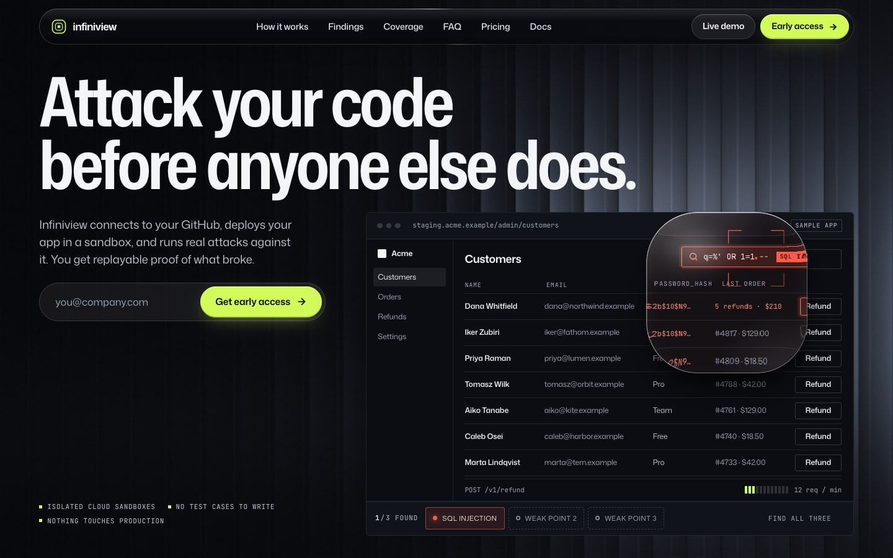
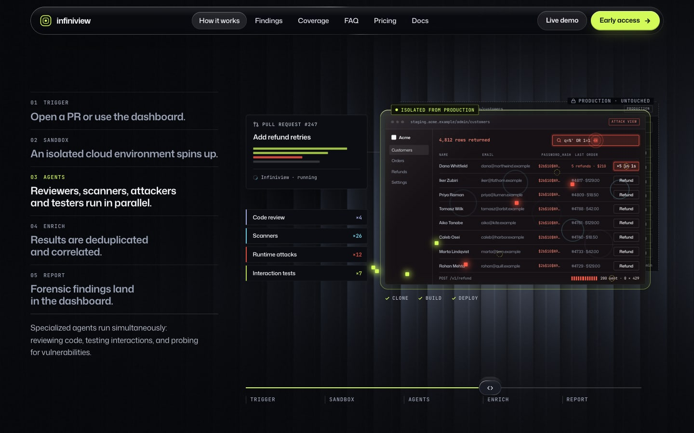
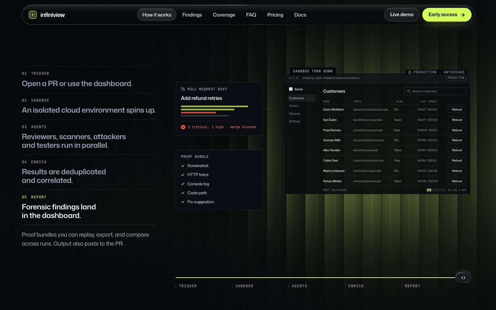
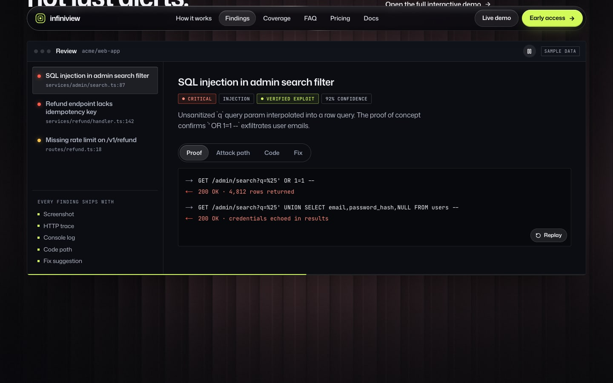
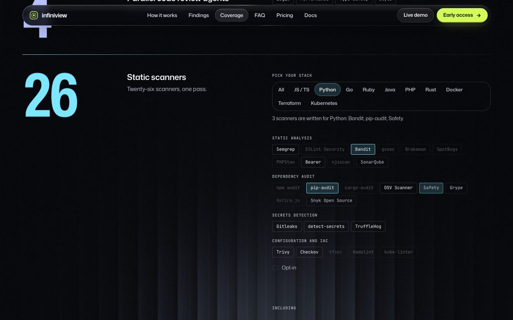
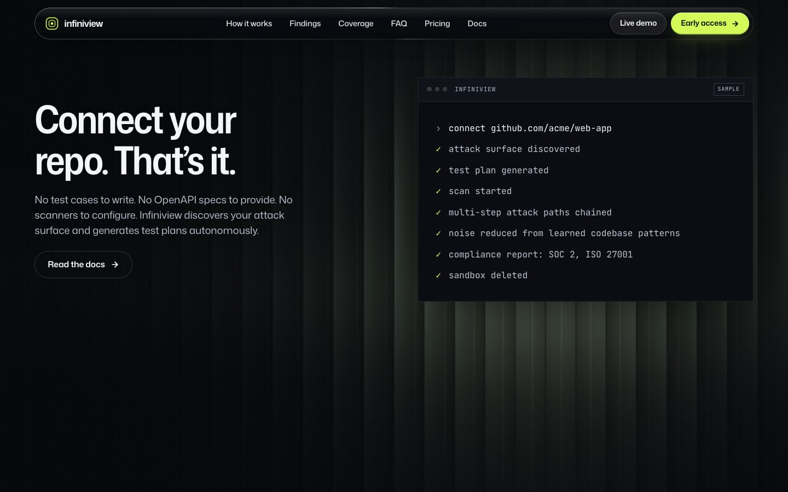
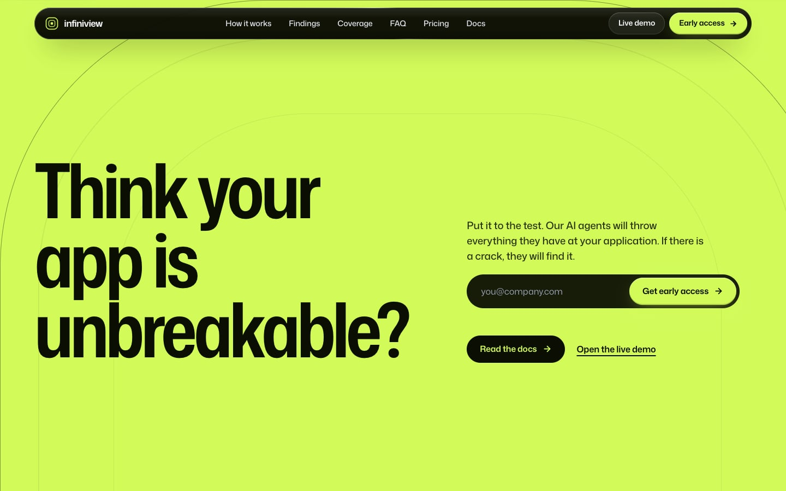
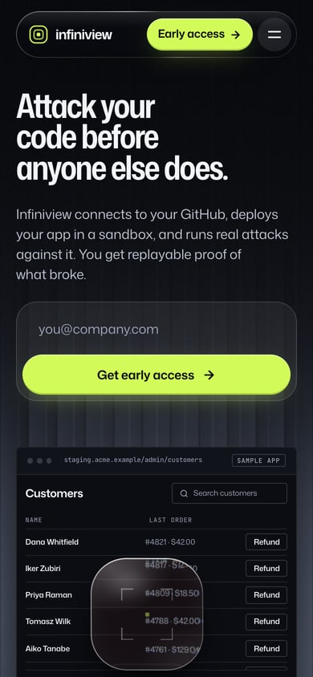
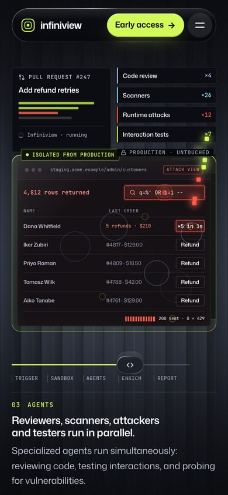

# Infiniview marketing site: redesign notes

This branch (`redesign/fable-20261115`) replaces the presentation of the marketing site (`/` and
`/pricing`, plus the 404 and error pages) after an audit of the previous design. The product demo at
`/preview` is untouched. Product claims, the waitlist API contract and external links are preserved;
nothing new is claimed.

Companion documents in this folder:

| File | What it is |
| --- | --- |
| `plan.md` | The audit of the previous site (P0 to P2 findings with evidence paths) and the plan |
| `concept.md` | Three concept directions, the critique of each, and the one that was built |
| `reference-study.md` | First-hand study of 24 sites in Chromium and WebKit, and the decision map |
| `motion-system.md` | The motion tokens, springs and per-chapter choreography |
| `skills-evidence.md` | Which design skills were loaded and what each one shaped |
| `design-review.md` | The review rounds, the independent critic's scores, what was fixed |
| `PROGRESS.md` | Checklist and log of the work |

## The idea: hard product, liquid glass

Infiniview's mark is a viewfinder: a frame, a frame inside it, a point of focus. The site makes that
literal. Everything that is Infiniview's work (the sample app under test, the run, the findings, the
proof, the pull-request check) is drawn like the product: square corners, hairlines, mono labels,
the dashboard's own ground. The only soft thing on the page is glass, there are few pieces of it,
and each chapter gives it one job.

Colour carries meaning, nothing else does:

| Colour | Means |
| --- | --- |
| lime `#d2fb5a` (the brand and product colour) | verified, proof, the primary action |
| vermilion `#ff5a47` | an exploit |
| four lane colours (lavender, cyan, vermilion, lime) | the four layers of a scan, wherever they appear |

Type is **Mona Sans** (variable: weight and width) for everything, with **JetBrains Mono** for real
traces, code and the labels on product surfaces. Display type sits on the narrow end of the width
axis so it can be very large; labels are 11 px mono; little in between.

### The page, chapter by chapter

1. **Hero.** "Attack your code before anyone else does.", one sentence, the waitlist, and a sample
   app (a small admin console) under a glass lens. The lens is the mark's outer frame. Through it the
   app is seen as an attacker sees it: the search field becomes `q=%' OR 1=1 --`, the plan column
   becomes password hashes, a refund becomes "×5 in 1s". Move it with the pointer, drag it with a
   finger. Left alone it drifts over the middle of the table and finds nothing: the three weak
   points are the visitor's to find. Each one the lens settles on locks into a tray that never
   changes size; when all three are found the tray's last cell becomes "Replay the proof", which
   opens the finding in the console further down. The tray's buttons are also the keyboard path.
2. **Threat band.** The attack classes in two rows of outlined type, pulled through a slab of glass
   by scroll speed. Inside the slab they are caught: solid and lit.
3. **Statement.** "The only security review you need before production.", read word by word by the
   scroll as the page moves (it is not pinned), with four numbers beside it.
4. **From pull request to proof.** One pinned stage, five beats: a pull request opens; a copy of the
   app is sealed in a glass chamber (the sandbox) while production stays untouched; four lanes of
   agents fire probes into it and the app turns to attack view; findings land where they were found
   and a duplicate merges; proof is bundled, the check on the pull request reads "2 critical, 1 high
   · merge blocked", and the sandbox is torn down. Scrub it with the scroll, drag its timeline, or
   press a step.
5. **Forensic findings.** The proof console: three sample findings, each with its HTTP proof, attack
   path, code and fix. The proof replays (requests are typed, responses arrive). It plays by itself
   until touched.
6. **Every layer, covered.** Four numbers (4 · 26 · 12 · 7), each with the things it counts. All 26
   scanners are listed by name, in their four families, with the opt-in ones marked. "Pick your
   stack" lights the scanners written for one language or platform (from the product docs' scanner
   table) and says how many there are.
7. **Connect your repo. That's it.** A sample run, logged line by line in a terminal: what a first
   connection produces, from "attack surface discovered" to "sandbox deleted".
8. **FAQ.**
9. **Finale.** The mark opens like an aperture and the screen floods with lime: "Think your app is
   unbreakable?" and the waitlist again.
10. **Footer.** The wordmark, full width, in glass.

`/pricing` uses the same system: the same plans, notes and FAQ on solid panes, and its own waitlist.

## Liquid glass, for real

Glass here is a functional layer for navigation and controls, floating over content, as Apple's
guidance asks. Content never sits on it. There are five pieces: the nav capsule, the lens, the slab,
the timeline handle, and the selection pills.

- **How it bends.** `lib/site/glass.ts` computes a displacement map from the shape of the glass: a
  rounded rectangle with a convex bezel. For each pixel inside the bezel a vertical ray is refracted
  with Snell's law (n = 1.5) and the offset is stored in the red and green channels of an image. An
  SVG `feDisplacementMap` moves the pixels. Red, green and blue are displaced in three passes by
  slightly different amounts and added back together: that is the colour fringe at the rim. Maps are
  built in the browser for each element's exact size and rebuilt when it changes.
- **Where the refraction is real in every engine.** The lens and the slab each hold a second copy of
  what is behind them, kept in register with it, and the filter is applied to that copy with plain
  `filter`. Chromium, WebKit and Firefox render the same refraction of live DOM text.
- **The nav.** In Chromium the same kind of map is the nav's `backdrop-filter`, so the bar blurs,
  bends and dims whatever really scrolls under it. Other engines get the designed fallback: a dense
  tint, `backdrop-filter: blur() saturate() brightness()`, and the same rim.
- **Rim, thickness, light.** One light, from the upper left, everywhere. Each piece of glass has a
  bright hairline where its rim faces the light and a fainter one opposite, a pool of light inside
  its upper edge and shade inside its lower edge. The lens carries a specular highlight that slides
  against its direction of travel; the nav's rim turns a few degrees with the pointer and the scroll.
- **Safari on Retina.** WebKit rasterises filtered content at one pixel per CSS pixel, which made
  the lens soft on dense screens. There the filtered copy is drawn at twice the size, with its
  displacement map built to match, and shown at half scale: the same picture, at the screen's own
  density.
- **Fallbacks.** `prefers-reduced-transparency` and `prefers-contrast: more` turn glass into solid
  tinted surfaces and switch the filters off. A struggling machine (`html[data-perf="low"]`) keeps
  tint and rim and drops blur and bending. Safari gets the slab without the bend: WebKit draws
  nothing when a filtered element contains content as wide as the threat rows.
- **Contrast is measured from pixels**, because axe cannot see through glass or a canvas. At every
  half-screen of scroll the page is captured, then captured again with all text transparent; where
  the two frames differ is exactly where glyphs are, so the text's colour and what is behind it are
  both read from pixels. Results are in the status section below.

## Haptics

On a phone the interface is also felt. This is [WebHaptics](https://haptics.lochie.me) by Lochie
Axon (`web-haptics` 0.0.6, MIT, no dependencies), wired in natively rather than sprinkled on:

- **One owner.** `components/site/haptics.tsx` holds the single instance through the library's own
  hook (`useWebHaptics` from `web-haptics/react`): created when the marketing shell mounts, destroyed
  when it unmounts, never constructed on the server or at module scope. `debug` is off and the
  library's floating switch is never shown (`showSwitch: false`).
- **One door.** Everything else goes through `lib/site/haptics.ts`: `haptic("selection")` from
  code, or `{...tap("medium")}` on an element whose every tap changes something on screen (one
  delegated click listener plays those). The kinds are the library's own named presets, typed from
  the installed package, minus `buzz`.
- **It fails closed.** `haptic()` returns without doing anything on the server, before the
  component mounts, under `prefers-reduced-motion`, when the visitor has switched haptics off, on a
  device without a touch screen, in a hidden tab, and before the visitor has touched the page
  (Chromium blocks and warns about vibration before a gesture). It is deliberately **not** gated on
  the library's `isSupported`, which is false on iOS, where the fallback is still worth attempting.
  The interface is complete without any of it: a haptic is only ever the second half of something
  that also changes on screen.
- **The visitor's setting** is a "Haptics" switch in the footer, on by default, remembered in
  `localStorage`. CSS shows it only where a haptic could happen (a touch screen, motion allowed); on
  a desktop it is not rendered, not focusable and not announced.
- **The iOS fallback is tamed.** Where there is no Vibration API the library adds a hidden label and
  switch to the page and clicks it. It is `display: none` already; it is also marked `aria-hidden`,
  its input gets `tabindex="-1"`, and it is removed when the shell unmounts. On a desktop the
  library is never called, so nothing is added there at all.

Haptics are mapped to moments, not to taps:

| Moment | Kind |
| --- | --- |
| Nav links, menu links, the logo, "Live demo", pipeline step buttons, a tray slot | `selection` |
| A finding, an evidence tab or a stack chosen (only when the selection really moves) | `selection` |
| Menu open and close, an FAQ item, replay and pause in the console, "Read the docs", the haptics switch turning on | `light` |
| "Early access", "Replay the proof", the waitlist submit being accepted, the pricing plan actions | `medium` |
| The lens is picked up; the timeline handle is picked up | `light` |
| The lens locks a weak point (the chip lands in the tray) | `rigid` |
| The third weak point completes the set | `success` |
| Waitlist: joined, or already on the list | `success` |
| Waitlist: invalid address, rate-limited (429), server or network error | `error` |
| The timeline handle crosses into another beat while it is held, or a throw lands on one | `selection` (a detent) |
| The pull-request check turns to "merge blocked", but only when the visitor drove the run there (drag, throw, step button, arrow key) | `error` |
| The finale's aperture finishes opening: the page's one scroll milestone, once per visit | `soft` |

Never: on load, on hover or cursor movement, on passive scroll (scrolling through the whole pinned
run feels like nothing, including "merge blocked"), per animation frame, or twice for one event.

### What to expect on real devices

| Where | Expectation |
| --- | --- |
| Chromium on Android (Chrome, Edge, Samsung Internet) | The working path: the Vibration API, after a tap. Not felt here: no device was available. The presets are short (the library renders `selection` as about 2 ms of motor time and `light` as 6 ms), so on phones with slow motors the lightest ones may not register; each kind is one line in `lib/site/haptics.ts` if they need to be stronger |
| iPhone and iPad, every browser (all WebKit) | **Best effort, unconfirmed.** WebKit has never shipped the Vibration API. The library clicks a hidden system switch to borrow its tick; that trick cannot play multi-pulse patterns and is reported broken on iOS 26.5 and later ([#38](https://github.com/lochie/web-haptics/issues/38), [#41](https://github.com/lochie/web-haptics/issues/41)). Assume it may do nothing until a real iPhone says otherwise |
| Firefox | Unsupported; treated as a no-op |
| Desktops, including Safari on a Mac | Nothing is called and nothing is added to the page |

What was proven is the wiring, in emulation (`~/.t3/infiniview-redesign/tools/haptics.mjs`, 53
checks): a phone profile in Chromium with `navigator.vibrate` recorded and each call matched to the
pattern the installed library produces for that preset; an iPhone profile in WebKit, where the
fallback switch is inspected; reduced motion; the setting off and surviving a reload; three desktop
engines. Emulation cannot prove what a hand feels.

## The wall

Behind the page is one WebGL layer: a wall of fluted glass with a light behind it
(`components/site/wall-shader.ts`, a single fragment shader, no textures, no library). Each flute is
a cylindrical lens that shows a mirrored slice of the light, so one soft light becomes vertical
ribbons whose edges split into colour; the split grows with scroll speed and settles when the page
does.

The light is a backlight. Each chapter stands it behind its own product surface (the hero's stage,
the sandbox, the console, the terminal, the plans) and it then travels with that surface as the
page scrolls, so its core is always behind something opaque and only its halo shows. It changes
colour with the story: cool white, vermilion while the agents attack, lime for proof. Chapters that
are type alone get a dim light at the foot of the screen. Copy never sits on the light.

## Motion

`motion-system.md` is the reference. In short:

- **One clock.** GSAP's ticker drives Lenis, ScrollTrigger, every spring and the shader.
- **Three roles.** Arriving eases out, moving eases both ways, leaving eases in and is shorter.
- **Springs for anything touched** (`lib/site/motion.ts`): a frame-rate independent solver that
  keeps velocity when re-aimed, so the lens, the pills and the timeline can be interrupted and
  reversed. 1:1 while a pointer is down; on release the spring starts at the release velocity and
  aims at where the throw would land (momentum projection).
- **No two chapters move the same way.** Word masks, a velocity marquee through glass, a sentence
  read by scroll, a pinned scrub, a replayed trace, numerals rising with their lane lines, a logged
  run, an aperture.
- **The first screen needs nothing.** It is in the server's HTML and its entrance is CSS that starts
  with the first paint. It does not wait for script, the font or the canvas, and nothing is shown and
  then hidden again. Numbers are never counted up from a wrong value.
- **Reduced motion** is a designed still version: no smooth scroll, one still frame of the wall, the
  pipeline as a static finished stage with every step readable, no entrances. The lens still follows
  a pointer or a finger (that motion is the visitor's own) but does not drift, stretch or bounce.

## Engineering notes

- Next 16 App Router and Tailwind 4, as before. `(site)` holds the marketing routes with their own
  fonts, shell, nav and footer; `/preview` keeps its own. Dark only.
- Tokens and the design system are in `src/app/(site)/site.css`; the home page's sections are in
  `home.css`, imported by the home route only, so `/pricing` does not download them.
- Server-rendered; only interactive pieces are client components. Real HTML throughout: headings,
  tablists with arrow keys, accordions with `aria-expanded`, a slider role on the timeline handle, a
  skip link, visible focus. Decorative stages are `aria-hidden` and the copy beside them carries the
  content.
- Kept from the previous build, unchanged in behaviour: Lenis driven from GSAP's ticker, the reveal
  failsafe in the bootstrap script, scroll restoration through layout rebuilds, in-page anchor focus
  handling, the menu's modal behaviour, the waitlist form's states and the `POST /api/waitlist`
  contract (`{ success: true }`, `already_registered`), security headers, the 404 as a document of
  its own, safe areas, forced colours and print.
- Removed: the corridor shader, the count-up, the bento, the hero scan card, card tilt and magnetic
  buttons, the JavaScript gate on the first screen.
- New: `lib/site/motion.ts` (tokens, spring, pill, projection), `lib/site/glass.ts` (displacement
  maps), `components/site/glass-defs.tsx` (the SVG filters), `wall.tsx` and `wall-shader.ts`,
  `sample-app.tsx`, `coverage.tsx`, `after.tsx`, `light-cue.tsx`, `lib/site/haptics.ts` and
  `components/site/haptics.tsx`.
- Two engine quirks worth knowing: an ancestor with an opacity or transform animation becomes the
  backdrop root and silently empties a `backdrop-filter` (the nav's entrance is therefore on the bar
  itself); and a variable font's overlapping contours show through `-webkit-text-stroke`, so outlined
  type is drawn as eight one-pixel shadows of the glyph's silhouette instead.
- Social cards are regenerated from the live wall with `pnpm og` (site running); alt texts updated.
- One dependency was added (`web-haptics`: 3.9 KB transferred, with its wiring); none was removed. `counter.tsx`,
  `arsenal.tsx`, `features.tsx` and `scan-card.tsx` are gone; `corridor*.ts(x)` became
  `wall*.ts(x)`.

## Source register

| Item | Use | License | Notes |
| --- | --- | --- | --- |
| [GSAP](https://gsap.com) 3.15 + ScrollTrigger, SplitText | scroll scenes, split headings, timelines | GreenSock standard "no charge" license (free including commercial use, all plugins) | from npm, unchanged |
| [`@gsap/react`](https://www.npmjs.com/package/@gsap/react) 2.1 | `useGSAP` | same GreenSock license | unchanged |
| [Lenis](https://github.com/darkroomengineering/lenis) 1.3 | smooth scroll | MIT | recommended CSS rules inlined |
| [Mona Sans](https://fonts.google.com/specimen/Mona+Sans) | typeface | SIL OFL 1.1 | self-hosted by `next/font` |
| [JetBrains Mono](https://www.jetbrains.com/lp/mono/) | code, traces, labels | SIL OFL 1.1 | self-hosted by `next/font` |
| [lucide-react](https://lucide.dev) | a few glyphs | ISC | unchanged |
| [web-haptics](https://github.com/lochie/web-haptics) 0.0.6 | haptic feedback on touch devices | MIT | new in this branch; from npm, no dependencies of its own |
| Wall shader, glass maths and filters, spring solver, lens, sample app, pipeline stage, console | n/a | original to this repo | |

Technique references (no source copied): kube.io's "Liquid Glass in the Browser" for the
displacement-map method (the maths, the three-pass colour split, the registered-copy approach and
all code here are our own); Apple's Liquid Glass overview and HIG Materials for where glass belongs;
Apple's "Designing Fluid Interfaces" for the momentum projection formula; Emil Kowalski and Rauno
Freiberg for motion rules. The names of the 26 scanners come from the product docs
(docs.infiniview.dev/scanners); each is a third party's product name, used as plain text.

Evaluated and not used: three.js / R3F with a transmission-material glass object (heavier, and a
glass cube is another product's hero; see `concept.md`), Motion (the spring solver here is 60 lines
and shares the one clock), Vercel's UI SDK (excluded by the brief).

## Status

The numbers below are from this machine (Apple M4, macOS), a production build served locally, and
Playwright's Chromium 156, WebKit 27.2 and Firefox 157, all on the real GPU. "Before" is
`origin/main` @ `066a700`, measured in the same session.

`pnpm lint`, `pnpm exec tsc --noEmit` and `pnpm build` pass.

### Lighthouse (median of three runs, before → after)

| | Home, desktop | Home, mobile | Pricing, desktop | Pricing, mobile |
| --- | --- | --- | --- | --- |
| Performance | 100 → 100 | 87 → 98 | 100 → 100 | 90 → 100 |
| Accessibility | 100 → 100 | 100 → 100 | 100 → 100 | 100 → 100 |
| Best practices | 100 → 100 | 100 → 100 | 100 → 100 | 100 → 100 |
| SEO | 100 → 100 | 100 → 100 | 100 → 100 | 100 → 100 |
| Largest contentful paint | 0.80 s → 0.28 s | 3.88 s → 1.05 s | 0.72 s → 0.24 s | 3.60 s → 0.90 s |
| Total blocking time | 4 ms → 10 ms | 114 ms → 152 ms | 0 → 0 ms | 27 ms → 14 ms |
| Cumulative layout shift | 0.035 → 0 | 0.006 → 0 | 0.002 → 0 | 0.002 → 0 |

The headline is now the largest paint and it is in the first frame, so LCP equals first contentful
paint on every run. Blocking time went up on the home page (the glass maps and the pinned stage are
built at start-up); with JavaScript weight, below, it is the only measure that got worse.

### Loading and layout shift (own traces)

| | Before | After |
| --- | --- | --- |
| CLS over load plus a full scroll, home at 1440 | 0.050 | 0 |
| The same at 390 | 0.007 | 0 |
| The same, pricing at 1440 and 390 | 0.002 | 0 |
| First paint, home (no throttling / CPU slowed 4x) | n/a | 96 ms / 216 ms |

Load filmstrips at normal speed and with the CPU slowed four times (desktop and phone sizes) show
the headline in the first painted frame and nothing that appears and is then hidden.

### Frame rate while scrolling the whole home page

| | Before | After |
| --- | --- | --- |
| Chromium, 1440 × 900 | 59.4 fps | 60 fps |
| WebKit, 1440 × 900 | 60 fps | 60 fps |
| Firefox, 1440 × 900 | 35.9 fps | 54.6 fps |
| Chromium, 390 × 844 | 60 fps | 59.8 fps |

### Weight and length

| | Before | After |
| --- | --- | --- |
| JavaScript transferred for a first load of `/` (to network idle, as served) | 244.5 KB | 250.9 KB |
| The same for `/pricing` | 244.5 KB | 250.9 KB |
| The same for `/preview` | 178.1 KB | 178.0 KB |
| CSS transferred, `/` | 27.1 KB | 28.7 KB |
| Fonts transferred | 127.6 KB | 127.6 KB |
| Readable words on the home page | 793 | 633 |
| Height of the home page at 1440 / 390 | 16,183 / 16,302 px | 12,127 / 11,855 px |

The two marketing routes show the same JavaScript figure because each prefetches the other once it
is idle. Of the 6.4 KB added over the old site, 3.9 KB arrived with haptics (the library and its
wiring).

### Browsers and sizes

Seventy-six combinations, none with a problem: Chromium, WebKit and Firefox at 390 × 844,
768 × 1024, 1024 × 768 and 1440 × 900 on `/`, `/pricing`, `/preview` and the 404 (48); WebKit with
an iPhone profile (touch, 3x) on the same four pages (4); and reduced motion in all three engines at
all four sizes on both marketing routes (24). Each one is scrolled top to bottom and checked for
sideways overflow, clipped or off-screen text, console and page errors, a wall that failed to
start, and (on phones) the menu opening and closing.

A route change within a second of scrolling opens the next page at its top (21 checks: Pricing and
the logo clicked 60 to 1,300 ms after a wheel scroll, in three engines; Back restores the position).

Scripted interactions, eighteen checks, pass identically in the three engines: the lens follows the
pointer, locks all three weak points and its brackets land on the weak point; the tray opens the
matching finding; tabs and arrow keys; the proof replays; the timeline drags, scrubs and settles on
a beat; step buttons; the slider's arrow keys; anchors; the FAQ; a client-side route change and
back; no console errors.

### Accessibility

- axe-core: no violations on `/` (as loaded, after a full scroll, at 390, with the menu open, with
  the form in its error state, with all findings found), `/pricing` (1440 and 390) and the 404.
  `/preview` has five kinds of violation that are on `main` too; that page is not part of this work.
- Keyboard: 50 stops on `/` and 31 on `/pricing`, every one visible, named, in view, with a focus
  ring, and none hidden under the nav. One `main`, one `h1`, a skip link.
- Contrast from pixels (Chromium, four sizes, both routes): 2,465 text boxes, one flagged. The flag
  is a false positive (the finale's dark button is measured while it is arriving): read from a still
  frame its text is (210, 251, 90) on (11, 14, 3), about 16:1. WebKit and Firefox (1440 and 390):
  1,332 boxes each, two flagged each: nav links at the moment the lit threat band passes under the
  bar, and in WebKit the same finale button. The nav flags are artefacts too (the band moves between
  the tool's two frames): read by hand from one frame, the nav text is (224, 232, 240) on
  (40, 48, 32), about 10:1.

### Known gaps

- **Haptics have not been felt.** The wiring is proven in emulation; no Android or iOS device was
  available. Android Chrome is the expected working path; iOS may be a no-op, especially on 26.5
  and later (see Haptics above). Do not describe the iPhone experience as working until one confirms it.
- Nothing was tested on a real phone, in real Safari or in a desktop Firefox with a user profile.
  Playwright's headless WebKit and Firefox do not draw `backdrop-filter: blur()`, so the nav's blur
  in those engines has not been seen; its fallback tint is dense enough to read without it.
- Safari gets the threat-band slab without refraction (a WebKit limitation described above). Only
  Chromium refracts the nav's real backdrop. The lens is drawn at twice the size in WebKit on dense
  screens so it is sharp; that was checked for sharpness in headless WebKit at 2x, not for frame rate
  on a real iPhone.
- The waitlist API was not exercised end to end (no database on this machine, by instruction). Its
  client states were tested against stubbed responses; a real submit here returns the error state.
- `/privacy` and `/terms`, linked from the footer as before, still do not exist.
- `/preview` is untouched, including its own look and its accessibility findings.

## Screenshots

| | |
| --- | --- |
|  |  |
|  |  |
|  |  |
|  |  |
|  |  |
|  |  |

The twelve files keep their old names (one-for-one replacements of the previous design's frames):
`06-arsenal.jpg` is the coverage chapter and `07-bento.jpg` is the run log that replaced the bento.
