# Infiniview marketing site — redesign notes

This branch replaces the marketing site's whole presentation layer (`/` and `/pricing`).
The product demo at `/preview` is untouched. Content, product claims, the waitlist API
contract and external links are preserved; nothing new is claimed.

## The idea

Infiniview's mark is a frame inside a frame. Its name is an *infinite view*. So the site is
that mark extruded forever: **a corridor of glass frames receding to a vanishing point, and
you travel down it by scrolling.** Every section is a chamber you cross into.

Glass is not decoration here, it is the product's vocabulary:

- a **sandbox** is a sealed, transparent chamber;
- **forensic proof** is evidence you can see through;
- a **view** is a lens.

Colour carries meaning, nothing else does:

| Colour | Means |
| --- | --- |
| cool white light | the world around the work |
| lime `#d2fb5a` (the existing brand + product colour) | verified, proof, defence |
| vermilion `#ff5a47` | exploit, breach |

Type is **Mona Sans** (variable, width + weight axes) for everything, with **JetBrains Mono**
reserved for real traces and code. Headlines are set tight and large; the width axis is used
on the threat marquee and the footer wordmark, and animates open on the hero headline.

### Sections as an argument

1. **Hero** — "Attack your code before anyone else does." A live sample scan streams in a glass card.
2. **Threat marquee** — the attack classes, pulled through the glass by scroll velocity.
3. **Statement** — "The only security review you need before production," read out word by word by the scroll, then four proof plates.
4. **From pull request to proof** — a pinned, scroll-scrubbed 3D exploded view of the real pipeline: PR → isolated sandbox → parallel agents firing probes into the app → deduplicated, correlated findings → proof bundle posted back to the PR, with the sandbox torn down.
5. **Forensic findings** — an interactive proof console (three sample findings × HTTP proof / attack path / code / fix). Auto-plays until you touch it.
6. **Every layer, covered** — an exploded stack of four glass layers; each layer's pattern literally contains its count (4 · 26 · 12 · 7). Selecting a layer lifts the ones above it away.
7. **Built around proof** — a bento where each tile has its own illustration (evidence cards, a receding-then-deleted sandbox, an attack chain, noise resolving into the mark, a compliance report, a zero-config terminal).
8. **FAQ** — sticky title, glass accordion.
9. **Finale** — the vanishing point opens like an aperture and floods the page with lime.
10. **Footer** — the wordmark at full width, in glass.

`/pricing` uses the same system with the same plans, notes and FAQ, and an in-page waitlist.

## Motion system

One clock, one scroll engine, no competing animators.

- **GSAP 3.15** (ScrollTrigger, SplitText) owns all choreography. **Lenis** owns smooth scroll and is driven *from GSAP's ticker*, so scroll, the WebGL scene and every tween share a frame.
- `components/site/shell.tsx` is the single owner of time: Lenis, damping of scroll → corridor depth, pointer → light, the pointer-lit glass rims, and the global scroll-reveal / split-heading system.
- **The corridor** (`corridor-shader.ts`) is a from-scratch fragment shader, not a library: a rounded-square tube solved analytically (superellipse radius → depth, no ray-marching), glass frames with constant z-thickness so perspective is exact, prismatic dispersion in *pixel* terms, ribbed secondary frames, agent "probes" running down the walls, and a portal at the vanishing point. Scroll sets camera depth; velocity adds roll and dispersion; each chapter nudges a shared `mood` (alert, energy, portal, width).
- Easing is `expo.out` / `power4.out` for arrivals and `power3.inOut` for transitions; feedback on controls is ≤ 0.3 s.
- **Performance**: the canvas renders at a fraction of device resolution with a frame-time governor that sheds pixels first and, only if that is not enough, sets `html[data-perf="low"]` which removes backdrop blur. Large, mostly-opaque panes do not blur at all. The loop pauses with the tab.
- **Progressive enhancement**: collapsing (pipeline steps, FAQ, arsenal layers) only happens when script is running, so with no script everything stays readable; collapsed copy is also removed from the accessibility tree rather than just clipped. A failsafe in the root layout reveals all marketing content if the app bundle never boots.
- **Reduced motion**: Lenis is off, the corridor renders one still frame, pinned scrub sequences become static layouts, everything is visible. Content is only hidden when script is present *and* will reveal it; a failsafe un-hides after 3 s (the entrance then simply does not play).
- **Touch**: pointer effects (tilt, magnetic buttons, rim light) are disabled on coarse pointers; the pinned pipeline restages for phones, and its stage is sized so the active step's copy always fits the screen (checked from 320×568 up). Screens under 560px tall (a phone in landscape) get the same static layout as reduced motion, because a pinned stage plus its copy cannot fit there.
- **Live preference changes**: switching reduced motion on or off while the page is open is honoured by the marquee, the scan stream, the magnetic buttons, the pointer light, Lenis smoothing and any smooth jump already under way (it is completed at once, focus included); content already revealed stays visible.

## Engineering notes

- Next 16 App Router + Tailwind 4 retained. Route groups: `(site)` for the marketing pages (own fonts, shell, nav, footer); `/preview` keeps its original fonts, tokens and theme toggle.
- Design tokens and the glass material live in `src/app/(site)/site.css` inside `@layer components`, so Tailwind utilities can still override.
- The page is server-rendered; only the interactive pieces are client components. Everything is real HTML (nav, headings, FAQ buttons with `aria-expanded`, tablists with arrow-key support, a skip link, visible focus). Decorative 3D stages are `aria-hidden` and the copy beside them carries the content.
- Two hydration traps found and fixed: trig-derived SVG coordinates differ between Node and browsers in the last float digits (rounded), and ScrollTriggers created *before* pinned sections measure wrong unless the pins refresh first (`refreshPriority`).
- Illustrative content is labelled ("Sample run", "Sample data", "Illustration with sample data") and derived from the existing `/preview` fixtures. No customers, quotes, logos or new metrics.
- **Social previews.** Each marketing page names its own 1200×630 card (home: the hero line; `/pricing`: its own headline, so a pasted pricing link does not unfurl as the home page). Both are rendered from the live corridor with the site's real typeface, shipped as ~120 KB JPEGs (WhatsApp and iMessage skip heavier images), carry alt text, and are checked by an end-to-end test for absolute URLs, dimensions and weight. The favicon set (`icon.svg`, `icon1.png`, `apple-icon.png`, `favicon.ico`) was regenerated from the new mark.
- `package.json` gains three dependencies (`gsap`, `@gsap/react`, `lenis`), and every dependency is at its latest release (Next 16.4.3, React 19.3.1, ESLint 10.13, lucide-react 1.61, `@neondatabase/serverless` 1.2, `tailwind-merge` 3.7, `@types/*`). The lockfile is regenerated with pnpm 10. ESLint 10 prints unmet-peer warnings from `eslint-config-next`'s bundled `jsx-a11y` and `react` plugins (they have not declared ESLint 10 yet); all rule families still run (verified against a deliberately broken file).

### Page edges and surfaces

The details at the edge of the viewport are part of the design, not leftovers:

- **Overscroll and rubber-banding.** `html`, `body` and the canvas fallback are all the same `#03040a` (set by CSS *and* by the inline bootstrap script before first paint, for every path except the legacy `/preview`), so pulling past either end of the page, or an iOS bounce, never flashes white. `color-scheme: dark` themes native scrollbars, form controls and the overscroll area; `theme-color` colours the mobile browser chrome. `/preview` keeps its own light/dark surface.
- **Safe areas.** `viewport-fit=cover` with `env(safe-area-inset-*)` on the nav, gutters and footer, so nothing sits under a notch, the Dynamic Island or the home indicator; `100vh` has an `svh` upgrade so phone URL bars do not cut heroes off.
- **Platform polish.** Themed scrollbars, autofill and caret colours, tap-highlight off, `text-size-adjust`, `prefers-reduced-transparency`, `prefers-contrast`, `forced-colors` and print styles.
- **404, error and global-error pages** are designed. The 404 is a document of its own (`global-not-found`, server-rendered, real 404 status) so the marketing stylesheet is loaded by the site routes only and never by `/preview`; the error page renders inside the site layout (nav and footer stay up); `global-error` is dependency-free inline styles. Plus a web manifest, maskable and Apple touch icons, and alt text for the social images.

### Security notes

- `POST /api/waitlist` keeps its contract (`{ success: true }`, `already_registered` on a duplicate). It now also requires `application/json`, caps the body at 2 KB (counted in bytes, and read as a stream that is cancelled at the limit, so a chunked upload cannot be buffered whole), validates the address type and length, and answers `415 / 413 / 400 / 429`. The 429 limiter (8 requests / 10 min per client IP) is **in memory, per server instance**: a best-effort brake, not a guarantee. It records only accepted requests (a client hammering after a 429 cannot grow its own history) and remembers at most 5,000 clients, forgetting the stalest first. The durable fix is a rate-limit rule at the edge or WAF.
- Response headers on every route: `X-Content-Type-Options: nosniff`, `Referrer-Policy: strict-origin-when-cross-origin`, a `Permissions-Policy` that denies camera, microphone, geolocation, payment and USB, and a restricted CSP (`base-uri`, `form-action`, `object-src 'none'`, `frame-ancestors` limited to this site and `*.infiniview.dev`). A full script-src CSP is not set: Next's inline bootstrap scripts need nonces, which would force every page dynamic. HSTS is left to the platform.
- Structured data is serialised with `<` escaped. The theme cookie is `Secure` over HTTPS. `.env*` is git-ignored except `.env.example`.
- Not changed on purpose: the `already_registered` response (product contract, low sensitivity) and the shared `.infiniview.dev` theme-cookie domain (shared with the product app).

### Accessibility and QA

- **Rendered states**: focus rings keep each control's shape (pills stay pills; Arsenal rows, FAQ questions and the mobile menu get rings that match their containers), the skip link is a readable lime pill, and every waitlist form state (idle, focus, typed, invalid, success, duplicate, error, rate-limited) was captured and reviewed on the dark pages, the lime finale and a phone. Split headings keep the tails of g, j, p, q, y and J (checked from pixels in Chromium, WebKit and Firefox).
- **Independent review rounds**: besides the bots and the code-review skill, three reviewers who had not seen the code tested the built site (desktop visuals from 1024 to 2560 wide; phones and tablets including 200% zoom and large text; keyboard, assistive-technology tree, forced colours, print, slow network, WebKit and Firefox). Everything they reproduced was fixed and is now a regression test: finale headline and stat numerals fitting their columns at every width, a constant-height findings console, scroll position surviving layout rebuilds, a waitlist that never claims success before the server has said so, focus kept out from behind the fixed nav, and more.
- **Last interaction-review round**: Resume on the findings console now plays at once (the pointer and focus are still on the button, and used to hold it); the Arsenal autoplay makes one pass and stops instead of looping forever; scrollable code regions are keyboard-focusable; the header waits for the motion layer instead of showing, vanishing and fading back in; the 404's links really navigate (it is a document of its own); the menu closes when the address changes or the window grows to desktop; a reload keeps the reader's place even though the pins are rebuilt after the browser restored it; the waitlist form is a POST to its API (an early native submit can no longer put an address in the URL) and announces its loading state.
- **Large text and forced colours**: with the root text at 200% from 320 px to 1440 px, neither route scrolls sideways or clips copy (scan rows, file paths and plan badges wrap; headings may break inside a word as a last resort; the nav switches to the menu button on its own width in ems, so enlarged text never crowds it). In forced-colours mode the header has a real surface, selected tabs and findings carry a line instead of a fill, severity dots differ by shape, and the evidence cards keep their borders.
- **Keyboard**: one tab walk covers every control on both routes; accordions and tabs have real roles, roving focus and Escape/focus-return for the menu. The e2e suite (about 60 real-input tests, run against a production build and the dev server under StrictMode) is green.
- **axe-core 4.14**: no violations on `/pricing`, the 404 page or the open mobile menu; the home findings (statement `aria-label`, hero cue label, unlit-word contrast) are fixed.
- **Contrast over a moving background** is something axe cannot evaluate (the corridor is a canvas), so it is measured from pixels: scroll in 0.3-viewport steps, screenshot, screenshot again with all text made transparent (so the true background under every glyph is sampled), and compare against WCAG AA at the 90th-percentile worst pixel. Phones (320, 390), tablet, 1280×720, 1440×900 and 1920×1080, both routes. That audit found and fixed: the nav glass being washed out by headlines scrolling under it, phone/tablet pipeline copy sitting on the portal (now on its own pane), body copy and the scan card over the portal's glow (denser tint, a soft halo on body copy, a dimmer portal in those chapters) and a few muted greys that sat just under 4.5:1.
- Layout was audited at 12 viewport sizes on both routes for horizontal overflow and clipped elements, and reviewed visually as contact sheets (phone, SE, iPad, tablet landscape, laptop, FHD).

### Weight (production build, gzip)

JS ≈ 263 KB · CSS ≈ 22 KB · fonts ≈ 126 KB (Mona Sans 96 KB, JetBrains Mono 31 KB) · HTML ≈ 18 KB.

## Source register

| Item | Use | License | Notes |
| --- | --- | --- | --- |
| [GSAP](https://gsap.com) 3.15 + ScrollTrigger, SplitText | choreography, scroll, text reveals | GreenSock Standard "no charge" license (free incl. commercial, all plugins) | installed from npm; not vendored |
| [`@gsap/react`](https://www.npmjs.com/package/@gsap/react) 2.1 | `useGSAP` | same GreenSock license | |
| [Lenis](https://github.com/darkroomengineering/lenis) 1.3 | smooth scroll | MIT | recommended CSS rules inlined; GSAP integration per its README |
| [Mona Sans](https://fonts.google.com/specimen/Mona+Sans) | typeface | SIL OFL 1.1 | self-hosted by `next/font` |
| [JetBrains Mono](https://www.jetbrains.com/lp/mono/) | code/trace face | SIL OFL 1.1 | existing dependency |
| [lucide-react](https://lucide.dev) | a few UI glyphs | ISC | existing dependency |
| Corridor shader, glass material, 3D stages, console, all patterns | — | original to this repo | |

**Evaluated and not used** (or used as reference only — no third-party source is copied):

- [Magic UI](https://magicui.design) (MIT) — Border Beam's masked-border technique informed the glass rim; re-implemented in plain CSS. Animated Beam / Number Ticker inspected; not needed.
- [React Bits](https://reactbits.dev) (MIT + Commons Clause) — `GlassSurface`'s SVG-displacement refraction inspected. Not shipped: it only works for `backdrop-filter` in Chromium, and the corridor already supplies the refraction cue everywhere.
- [Paper Shaders](https://github.com/paper-design/shaders) (Apache-2.0) and [OGL](https://github.com/oframe/ogl) (Unlicense) — evaluated for the background; a bespoke shader fit the "frame inside a frame" idea better and avoids a dependency.
- [Aceternity UI](https://ui.aceternity.com), [21st.dev](https://21st.dev), [Osmo Supply](https://osmo.supply) — benchmarks and inspiration only. Their licence terms for free components were not stated where we could read them, so nothing was copied.
- Codrops (3D scroll tutorials) and the kube.io liquid-glass write-up — technique references.
- Official GSAP agent skills — read for correct `useGSAP` / ScrollTrigger / SplitText usage; not installed into the repo.

## Honest status

Finished: both marketing routes, mobile / tablet / laptop / large-desktop layouts, reduced-motion path, keyboard-operable controls, working waitlist form (client side), regenerated social images.

Not done / worth knowing:

- **Dark only.** The old light theme is dropped on the marketing pages (the glass-over-light-field look needs its own design pass). `/preview` keeps its theme toggle.
- **Frame rate was not measured on real GPUs.** Visual QA ran in headless Chromium (software GL). The adaptive governor and the `data-perf="low"` fallback exist for that reason; they should be checked on a mid-range laptop and a phone.
- **Real devices.** The site was checked in Chromium, WebKit (the Safari engine, 27.2) and Firefox 157 on desktop and phone sizes (layout, glass, WebGL, fonts, descenders, focus), but not on real iPhones or Androids: rubber-banding and notch behaviour are built to spec, not seen.
- The waitlist API was not exercised end to end (no `DATABASE_URL` locally); the client states (invalid, pending, success, already registered, server error, rate limited, timeout) were, against stubbed responses.
- `/privacy` and `/terms` are linked as before but do not exist in this repo.
- Pricing figures remain "Free / TBD / Custom", as before.

## Screenshots

| | |
| --- | --- |
| 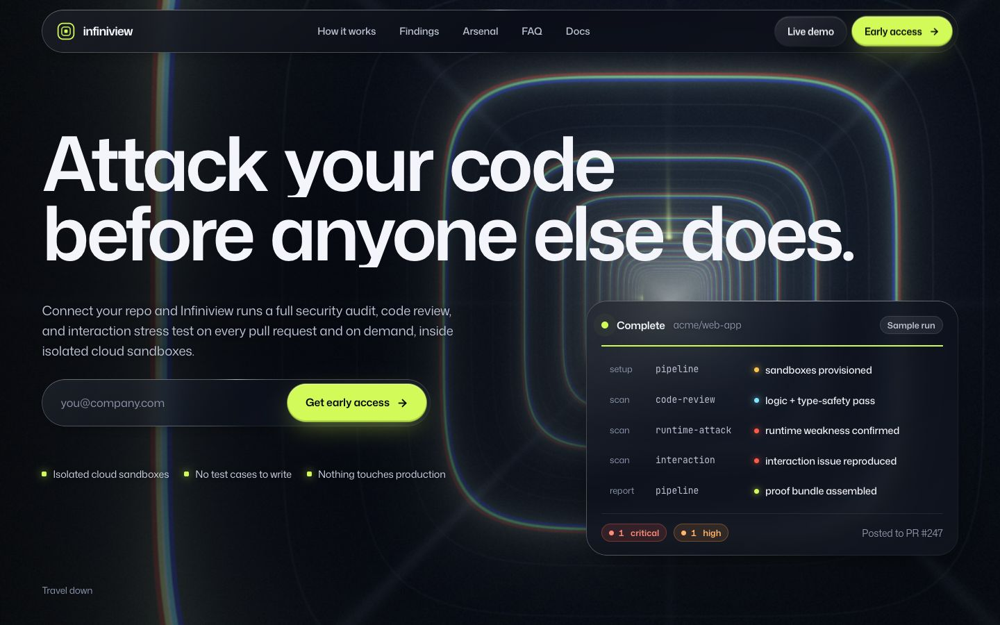 | 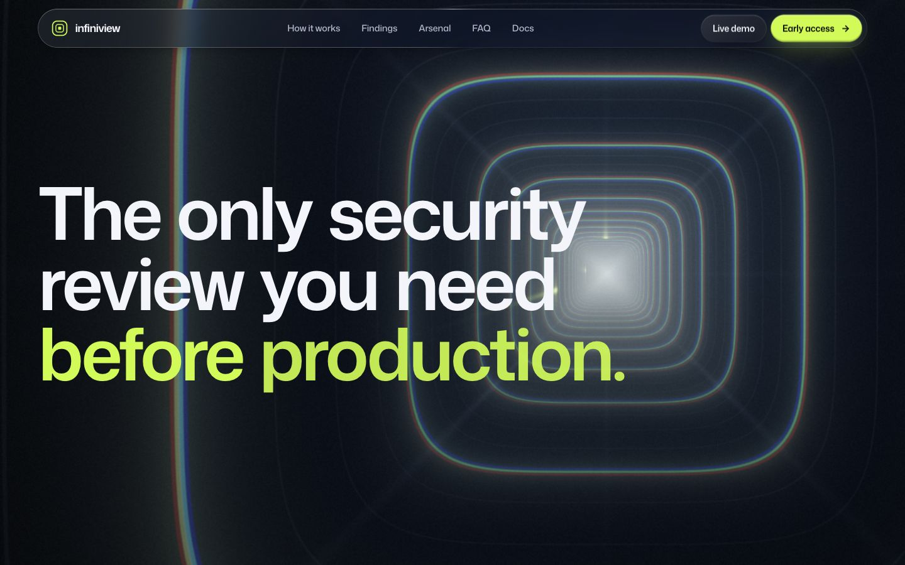 |
| 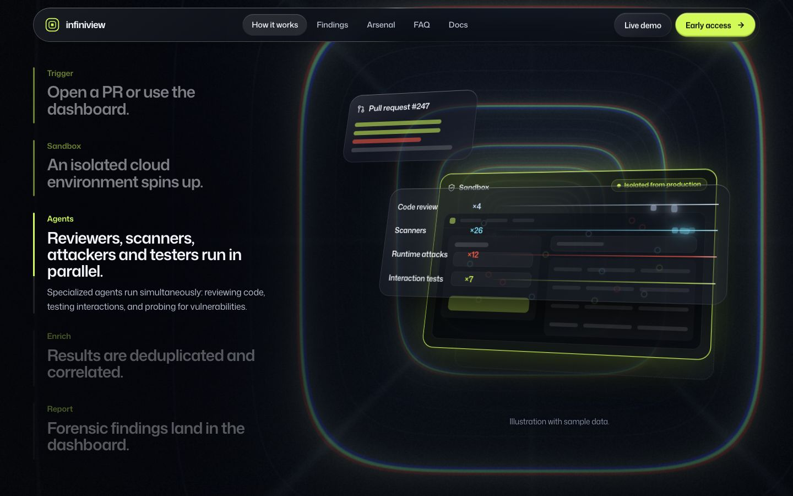 | 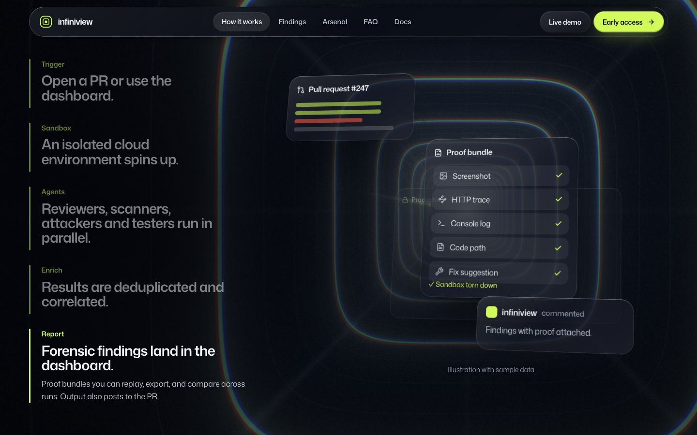 |
| 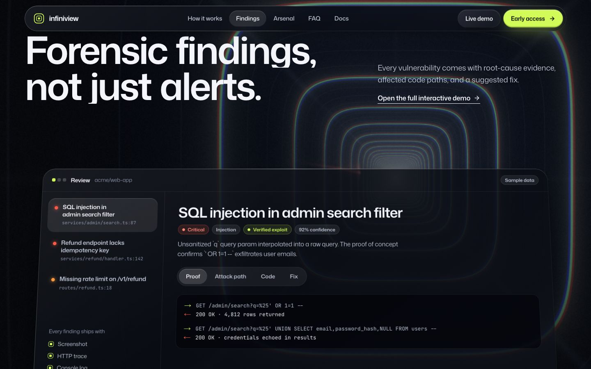 | 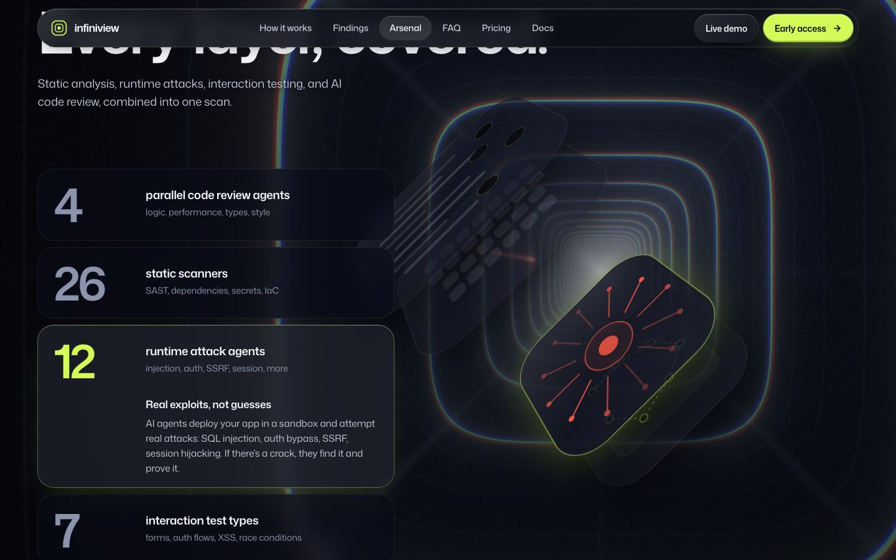 |
| 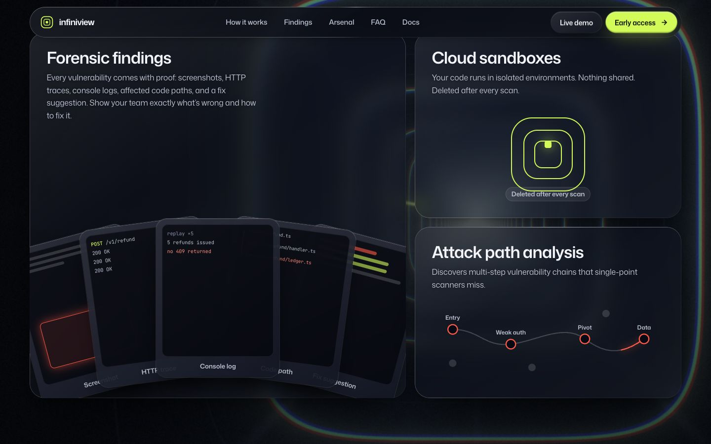 | 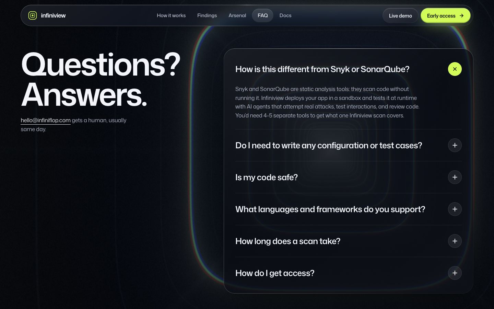 |
| 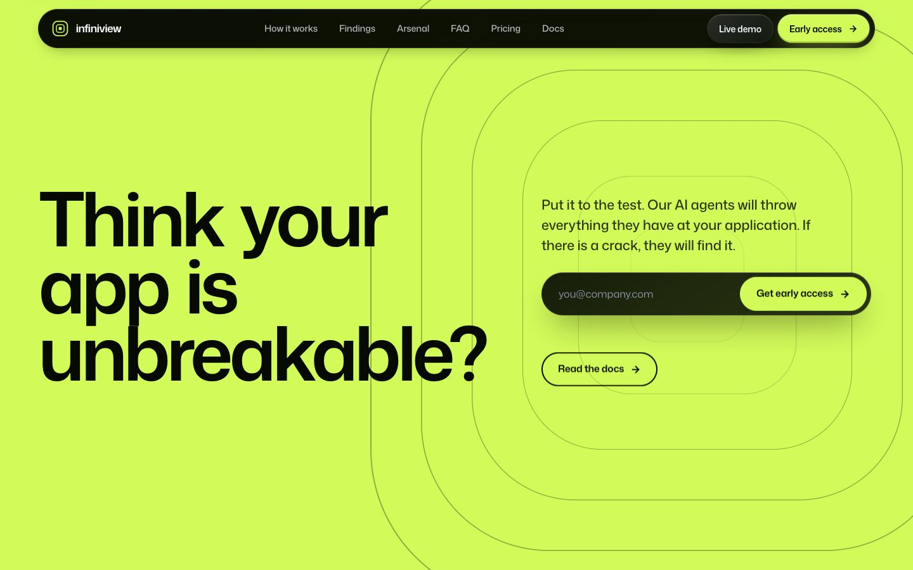 | 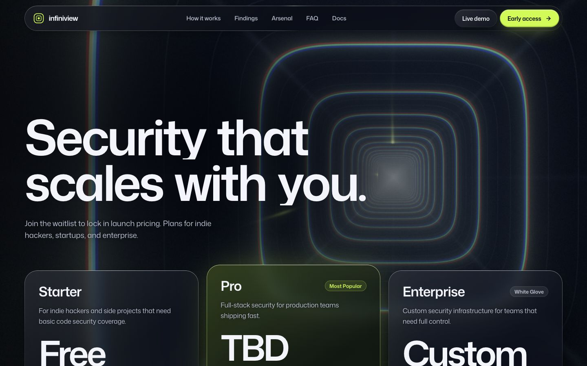 |
| 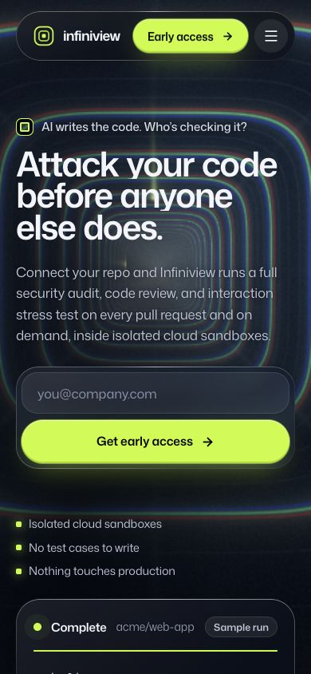 | 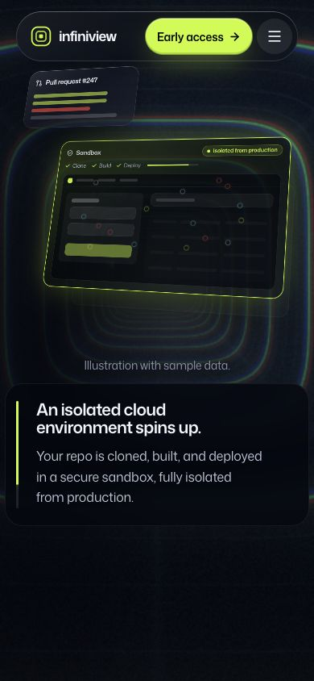 |
